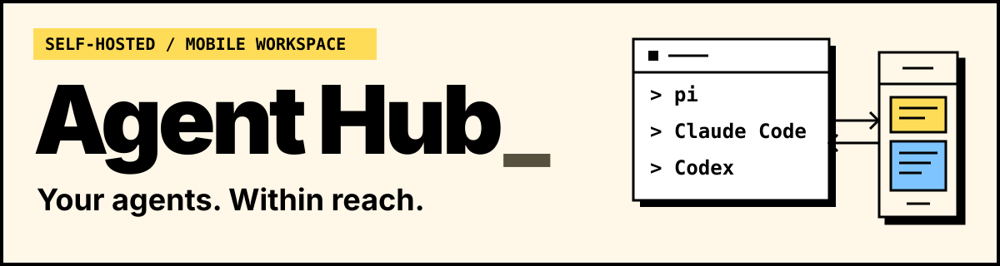
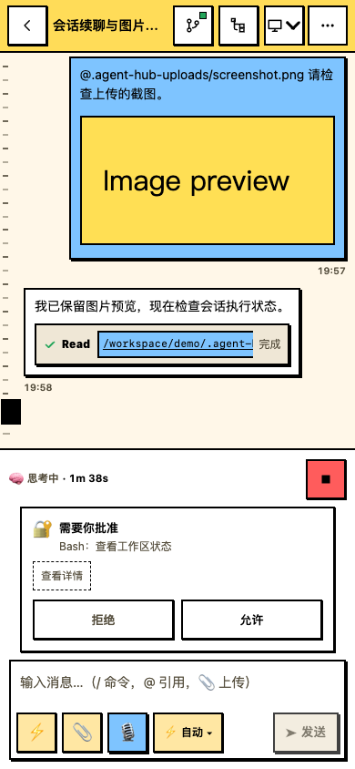
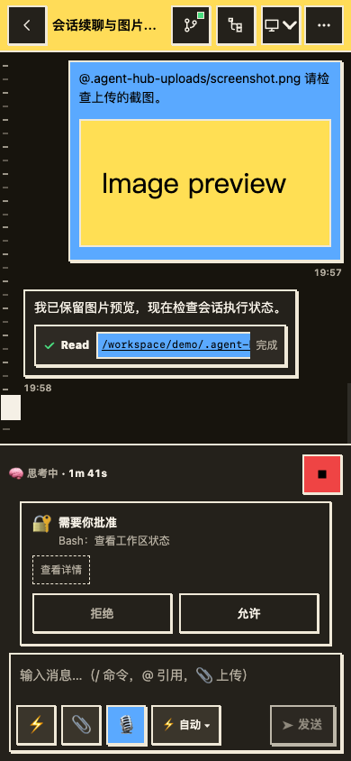
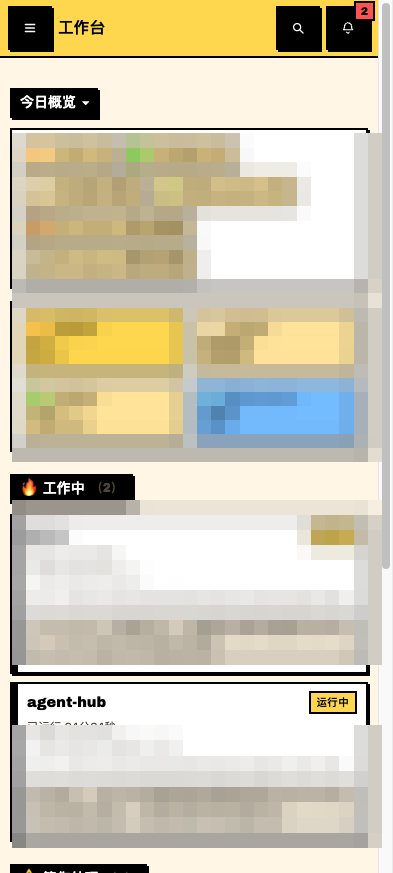
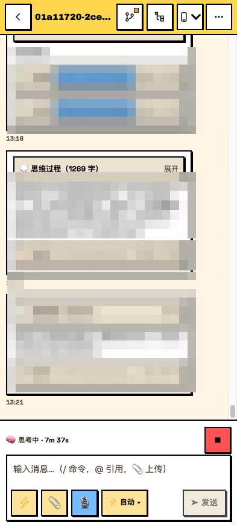
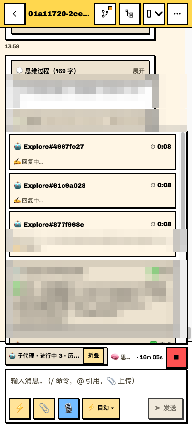
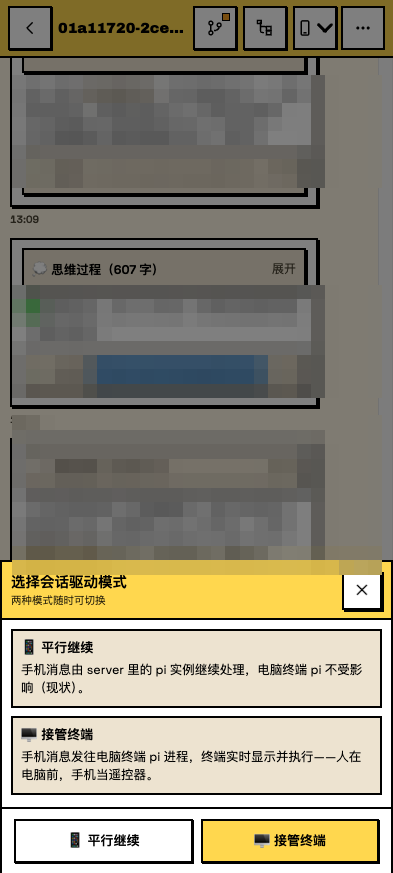

# Agent Hub

English · [简体中文](README.md)

[](https://github.com/newObjectccc/agent-hub-public/actions/workflows/ci.yml) [](https://www.npmjs.com/package/@newobjectcccddd/agent-hub) [](LICENSE)

<p align="center">
  
</p>

**Check, continue, and manage your computer's pi / Claude Code / Codex sessions from your phone.**

Agent Hub is a self-hosted mobile workspace. Open a browser to follow progress, continue a conversation, send tasks, and respond to agent questions and permission requests. It runs on macOS, Linux, and Windows, installs as a PWA, and supports English and Chinese.

[Quick start](#quick-start) · [What you can do](#what-you-can-do) · [Support and limits](#support-and-limits) · [Documentation](#documentation)

**Reading guide: the complete reference is retained in the “Expand…” sections below, collapsed by default. Open them to read setup details, all features, sending rules, configuration, and operations commands on this page, or use the separate [usage and operations guide](docs/USAGE.en.md).**

## See it in action

| Light | Dark |
| :---: | :---: |
| <a href="docs/screenshots/claude-v03-390-light.png"></a> | <a href="docs/screenshots/claude-v03-390-dark.png"></a> |

This Claude example shows image previews, tool cards, and phone approval with a confirmation-based permission setting. Open an image for the full-size view. Capabilities vary by agent; see [support and limits](#support-and-limits).

<details>
<summary>Expand the full demo and gallery: workbench, chat, sub-agents, modes, and app lock</summary>

### Screenshots

<p align="center">
  
</p>

| 🗂 Workbench | 💬 Chat workspace |
|---|---|
|  |  |
| **🤖 Multi-subagent panel** | **📱 Dual-mode drive / 🔐 App lock** |
|  |   |

</details>

## Quick start

On the computer, prepare **Node.js ≥22.19** and **at least one of pi, Claude Code, or Codex**, already installed, signed in, and able to chat. The npm package includes frontend and backend builds; Git, pnpm, and a local build are unnecessary.

```bash
npm install -g @newobjectcccddd/agent-hub@beta --registry=https://registry.npmjs.org/
agent-hub start
```

Open **http://127.0.0.1:7700** on the computer, choose an existing session, and send a small task to confirm a reply. If the list is empty, create a session in the computer's agent CLI and refresh the workbench.

Use the full scoped package name; the unscoped `agent-hub` belongs to another project. For a temporary trial, use `npx --registry=https://registry.npmjs.org/ @newobjectcccddd/agent-hub@beta start`. These commands select the official npm registry for this invocation only.

### Connect your phone

Stop the current foreground instance, then choose one connection method:

- **Across networks, Tailscale recommended**: install and sign in to Tailscale on both devices, then run `agent-hub remote` on the computer. Authorize MagicDNS / HTTPS when prompted. Once the CLI reports **Tailscale Serve enabled (HTTPS)**, open its printed `https://<node>.<tailnet>.ts.net` address on the phone.
- **On the same trusted LAN**: run `agent-hub start --lan`, then open `http://<computer-LAN-IP>:7700` on the phone. HTTP limits PWA installation and some browser features.
- **With your own network or reverse proxy**: use your existing network and authentication setup. See [Headscale](docs/HEADSCALE.md) and [security](SECURITY.md).

Tailscale is optional. Keep the computer awake and online, with Hub and the relevant agent runtime available. Use Chrome's install entry on Android, or Safari's Share → Add to Home Screen on iPhone.

**Execution permissions**: by default, pi executes tools directly, Claude uses `bypassPermissions`, and Codex uses `never` + `danger-full-access`. A task can automatically read or write files and run commands on the computer. Read the [permission and sending behavior guide](docs/USAGE.en.md) before sending work.

For autostart, stop the foreground instance first, then run `agent-hub setup --autostart` from a global install. Use `agent-hub check` for diagnostics. See the [installation guide](docs/INSTALL.md) for complete steps and troubleshooting (Chinese).

<details>
<summary>Expand full setup: npm / npx, persistent configuration, Tailscale consent, and source startup</summary>

### Quick Start (npm Beta)

Starting with Beta.3, new pi sessions can choose a configured provider/model, and existing chats show their model above the composer. If terminal pi works with Grok but a new Hub session gets a provider 403, choose `xai / grok-4.5` when creating it, or use **Change model** in an idle chat and retry the failed message manually. Context stays intact and the saved pi default stays unchanged. In the terminal `/model` picker, **Enter changes only that session; Ctrl+S saves the default** ([pi model docs](https://pi.dev/docs/latest/models)). Finish any run and exit a terminal holding the same session before changing its model. The list reflects the Hub process's local pi configuration; provider access and quota still apply. See the [installation troubleshooting guide](docs/INSTALL.md#pi-模型与-403-排查).

Prepare **Node.js ≥22.19 (includes npm)** and install/sign in to **at least one of pi, Claude Code, or Codex** on the computer. The hub reuses that agent's local authentication and model configuration; you do not need all three CLIs. Keep the computer awake, online, and the hub running.

A global install is recommended for regular use and autostart. The npm package includes the frontend and backend builds: **no Git, pnpm, or on-device build is required**.

```bash
npm install -g @newobjectcccddd/agent-hub@beta --registry=https://registry.npmjs.org/
agent-hub remote
```

For a temporary trial, use `npx --registry=https://registry.npmjs.org/ @newobjectcccddd/agent-hub@beta remote`. These commands select the official npm registry for this invocation and preserve existing company registry settings. The unscoped `agent-hub` is an unrelated package; use the full scoped name. Global installs and npx share `~/.agent-hub/config/hub.config.json` and `~/.agent-hub/data/`, so changing versions or clearing the npx cache does not erase configuration, the app lock, or runtime state.

The first `remote` generates configuration, installs pi terminal extensions when applicable, and attempts to configure Tailscale Serve. It is safe to repeat. **Tailscale is the recommended optional remote-access method, not a required Hub dependency.**

| Access method | Command | Prerequisites |
|---|---|---|
| This computer | `agent-hub start` | Defaults to `http://127.0.0.1:7700`; no Tailscale needed |
| Trusted LAN | `agent-hub start --lan` | Both devices on the same LAN; HTTP limits PWA installation |
| Across networks (recommended) | `agent-hub remote` | Install and sign in to Tailscale on both devices |
| Your own network / reverse proxy | `agent-hub start` | Use your existing network and authentication; see [security](SECURITY.md) and [Headscale](docs/HEADSCALE.md) |

Starting with `0.3.0-beta.2`, the CLI supports `remote --lan`, `remote --no-tailscale`, and `setup --autostart --no-tailscale` to skip automatic detection. With npm `0.3.0-beta.1`, use the `start` commands above for local or LAN access.

#### Connect the computer and phone with Tailscale

1. If you choose this recommended method, install [Tailscale](https://tailscale.com/download) on both devices, sign in with the same account, and connect to the same tailnet. The computer needs a working Tailscale CLI; Beta.2 and later also discover the macOS app's bundled CLI and the default Windows installation path. Custom ACLs must allow the phone to access the computer.
2. First-time Serve setup requires MagicDNS and HTTPS certificates. Follow the authorization URL printed by the CLI, or enable them on the admin console's DNS page. See the [official Serve guide](https://tailscale.com/docs/features/tailscale-serve).
3. Run `agent-hub remote` on the computer. The remote entry is ready when it reports **Tailscale Serve enabled (HTTPS)** and prints `https://<node>.<tailnet>.ts.net`.
4. Open that HTTPS URL on the phone. Use Chrome's install entry on Android, or Safari's Share → Add to Home Screen on iPhone. Set an app lock if desired, then choose a session in the workbench.
5. Send a small task and confirm a real agent reply. If there is no history yet, create a session in the computer's agent CLI and refresh the workbench.

The user completes account sign-in, HTTPS consent, and phone system prompts. Their own agent can handle installation, configuration, and startup. Signing both devices into Tailscale alone does not start the hub or its HTTPS endpoint.

For autostart, stop the foreground process with Ctrl+C, then run `agent-hub setup --autostart`. Avoid two simultaneous instances. Register autostart from a global install, not a temporary npx cache. Use `agent-hub check` for diagnostics. See the [new-computer installation guide](docs/INSTALL.md) for checks and troubleshooting.

#### Run from source

Source development requires Git and pnpm 10. Choose one startup mode:

```bash
git clone https://github.com/newObjectccc/agent-hub-public.git
cd agent-hub-public
npm install -g pnpm@10
pnpm install --frozen-lockfile
node cli/setup.js
npm run start
```

For phone access, replace the last line with `npm run remote`; for live development, use `npm run dev` (frontend `http://localhost:5173`). Do not run all modes simultaneously. `pnpm setup` is pnpm's own command; use `node cli/setup.js` for this project's setup.

See the [installation guide](docs/INSTALL.md) for Beta validation scope. Codex approval cards are wired, but real command, file, and permissions approval flows still require separate end-to-end validation. See the [Codex driver guide](docs/CODEX_DRIVER.md).

</details>

## What you can do

- **Find the sessions that need you**: see all three agents' sessions, running states, and unread messages; filter by source, search, rename, or fork a session.
- **Keep working away from your desk**: continue from saved context, choose parallel or takeover mode, and follow streaming replies and tool activity.
- **Give tasks enough context**: upload images, reference files and messages, and use quick prompts, slash commands, voice input, and restored drafts.
- **Follow multiple agents**: see pi / Claude sub-agents' current tools, output summaries, and runtimes, plus token and cost totals and read-only Git status and diffs.
- **Make the decisions that need you**: receive completion notifications, answer model questions, and handle approvals when required by the agent's permission policy.
- **Use your preferred setup**: light and dark themes, English and Chinese, PIN / WebAuthn app lock, an offline message queue, and an optional ttyd web terminal.
- **Choose pi session models (Beta.3)**: pick a configured provider/model for a new session, or change it while an existing chat is idle. Context and global defaults stay intact. [Model and 403 troubleshooting](docs/INSTALL.md#pi-模型与-403-排查) (Chinese)

<details>
<summary>Expand the complete feature list and agent-specific capabilities</summary>

### Features

- **🧩 Three session sources**: pi / Claude Code / Codex in one list, detail view, and drive channel (Codex includes desktop-app sessions: tool cards / usage accounting / archived sessions 📦)
- **📱 Dual-mode session drive**: 🖥 Takeover (pi: inject messages into the existing terminal process; Claude: the hub starts a persistent CLI process resuming the same session, with tmux mirroring; phone-side permission approval applies only on non-bypass tiers, the default bypass tier runs fully automatic) / 📱 Parallel continue (resume context through the server; pi tool calls really execute on your computer with no human approval, stated up front on first entry). Both modes support all three sources. Codex takeover is manual by default, with native steer/interrupt, phone approval cards (real command, file-change, and permissions flows still require end-to-end validation) and images; it does not control the original desktop window. See [Codex driver](docs/CODEX_DRIVER.md). Defaults are configurable, and your manual choice takes priority. Parallel sends are blocked with an actionable reason while a computer terminal is writing the same session (anti double-write fork); model/network failures surface inline in the bubble with the original text and a self-help action. See the mode guide below.
- **🤖 Sub-agent activity panel**: sub-agents from pi **and claude** shown live (current tool / output summary / runtime), like a terminal multi-agent panel
- 🔴 **Live spectating**: watch the thinking chain, streaming replies, and tool calls of terminal pi sessions from your phone (token-level)
- 🗂 **Workbench home**: organized by attention (🔥 working / ⚠️ needs you / today's overview), real data only; today's overview broken down by source (pi/claude/codex), with per-source filter chips
- 📈 **Token usage**: today / 7-day / all-time token & cost rollups, per-session usage badges
- 💬 **Chat workspace**: staged waiting feedback, slash commands, quick-prompt templates, @ file references, image uploads, quoted replies, code highlighting & copy, GFM tables, voice input, draft auto-restore
- 📊 **Session management**: priority ordering, sub-agent parent–child tree, global search, branch tree, session forking, session renaming, source filtering (pi/claude/codex)
- 🌿 **Git integration**: repo status, diff viewer, tool-call ↔ file linking (read-only, safe)
- ⚡ **Performance**: WS batching, message memoization, windowed long sessions (12–15× streaming render, 21× DOM slim-down); server-side brotli compression + long-lived cache for hashed assets (weak-network / remote friendly)
- 🔔 **Notification center**: session-completion banners / vibration / sound, unread aggregation, tap-to-read
- 🔐 **App lock + offline queue**: PIN / WebAuthn passkey unlock, queued messages auto-resend when back online
- 🖥 **Web terminal** (ttyd optional): a real terminal right inside the panel
- 🌐 **Bilingual UI (i18n)**: switch the interface language between follow-system / 中文 / English in one tap, persisted

</details>

## How it works

```text
Phone / browser  ⇄  Agent Hub on your computer  ⇄  pi / Claude Code / Codex
                        HTTP + WebSocket            local runtimes and session files
```

Hub reuses each local agent's authentication, model configuration, and session records; you only need the agents you use. Session files remain the source of truth: pi in `~/.pi/agent/sessions/`, Claude in `~/.claude/projects/`, and Codex in `~/.codex/sessions/`. You host Hub and its session records yourself. Model requests still follow the selected agent and provider configuration.

<details>
<summary>Expand the architecture diagram and repository directory guide</summary>

### Architecture

```
Mobile PWA ──HTTP/WS──▶ server (Fastify) ──▶ pi SDK / claude CLI / codex CLI
                          │                    │
                     terminal layer          session files (single source of truth)
                  (tmux/ttyd/Tailscale)      (pi ~/.pi/agent/sessions,
                                             claude ~/.claude/projects,
                                             codex ~/.codex/sessions)
```

| Directory | Description |
|---|---|
| `server/` | REST + WS, pi/claude/codex adapters, KPI / notifications / git / terminal integration |
| `web/` | PWA (React + Vite + Tailwind v4, brutalist compact UI) |
| `cli/` | Cross-platform dev/setup/start/remote/check/open (pure Node, zero bash dependency) |
| `integrations/` | pi extensions (live-feed streaming / pi-command reverse control), Claude permission MCP bridge |
| `docs/` | API contract, architecture, platform details, headscale guide (HEADSCALE.md), roadmap |
| `docs/headscale/` | Self-hosted headscale control-plane deployment files (docker compose + Caddy auto-HTTPS) |

</details>

## Support and limits

- **pi**: parallel continuation and takeover through its terminal extension; live spectating when the extension is online. Tool calls execute on the computer.
- **Claude Code**: takeover starts a new CLI process resuming the same session, optionally visible through tmux. It does not control the original TUI window. Both modes use the configured permission setting. [Claude driver](docs/CLAUDE_DRIVER.md)
- **Codex**: reads desktop-app sessions; defaults to parallel continuation. Select takeover manually after exiting other clients writing the same session. Takeover requires Codex CLI ≥0.162, including that alpha series. Question and approval cards are wired; real command, file-change, and permissions approval flows still need separate end-to-end validation. [Codex driver](docs/CODEX_DRIVER.md)
- **Session continuity**: resume saved history after the original terminal closes. Closing the phone page does not stop accepted work. Restarting Hub preserves history but does not resume tasks or takeover automatically. Avoid writing the same session from both devices at once.
- **Deployment boundary**: local-only binding and no API authentication by default. Use a trusted private network or an authenticating reverse proxy for remote access; do not expose Hub directly to the public internet. App lock and API tokens serve different purposes. The bundled PWA cannot enter a Bearer token, so `auth.token` alone is unsuitable for public access. [Security policy](SECURITY.md) · [Full configuration](docs/USAGE.en.md#configuration)
- **Validation scope**: macOS / Linux local and CI records are described in the installation guide. Native Windows and real cross-device connections still require checks in the target environment.

<details>
<summary>Expand full session rules: sending behavior table, defaults, permissions, and failures</summary>

### Resuming old sessions and choosing a mode

Completed sessions can continue: sending from your phone starts a new turn from saved context even after the original computer terminal has closed. Opening a session does not resend old tasks, and a session title does not indicate its current run status. The computer's hub service and the relevant agent runtime must be available. Closing the PWA does not stop accepted work; restarting the hub does not automatically resume execution or takeover.

| Claude scenario | Sending behavior |
|---|---|
| Parallel, idle | The hub starts a CLI run; the original terminal can stay closed |
| Parallel, a hub-owned run is busy | Normal send returns busy; both steer and follow-up queue until that run ends |
| Parallel, an external terminal is busy (pi / Claude) | All three modes return busy (pi: `EXTERNAL_ACTIVE`, Claude: `SESSION_BUSY`) with an actionable reason; parallel mode cannot queue into that terminal |
| Takeover | The hub owns a new persistent CLI process; steer is handled between tools, follow-up after the turn; a normal send while busy fails through the command acknowledgment |

pi parallel continue resumes through an SDK instance inside the hub process: **tool calls (file reads/writes, shell commands) really execute on your computer with no human approval** — use it only in repos you trust. Claude parallel defaults to `--permission-mode bypassPermissions`: tools **run automatically on your computer with no human approval** (same risk class as pi — use only in repos you trust); set `claudeDriver.permissionMode` back to `manual` or another confirmation-gated tier in the hub config — confirmation-gated tiers surface an approval card on your phone on **both** the parallel and takeover paths (same HostRequestCard; allow/deny to continue). Model/network failures (including out-of-credits, connection errors and context overflow) do not throw in pi; they land on the message's stopReason, and the hub surfaces them as an inline error bar: context overflow offers a one-tap "compact context" self-help, manual abort uses a neutral tone. Error notices stay until dismissed. Messages blocked by the double-write gate, or not executed by the terminal, fall back to the offline queue and keep a failed bubble with a retry entry — the text is never lost.

Codex also defaults to full execution permissions on both paths: no operation approvals and full file/network access within the current OS account. Model questions still wait for your answer card. Existing explicit `inherit` or stricter choices remain in effect across upgrades.

Claude takeover does not control the original TUI window. Avoid simultaneous input there during takeover; tmux mirrors the hub process. External activity detection uses file timestamps, and its quiet window is not a process lock.

With the default `active-only` policy, pi defaults to takeover when its terminal extension is online. Claude attempts takeover when `status=running` **or** `lastDrivenBy=terminal`; otherwise it defaults to parallel. `always` attempts takeover on every open; `never` requires a manual choice. Manual choices take priority, while quiet-window checks, the enabled switch, and concurrency limits still apply.

One completed assistant message can be followed by more tools. The page confirms completion through turn-end events and server status; after five seconds of silence it checks status rather than marking the task complete.

Uploaded images appear as thumbnails. Claude's image dimensions/coordinate hints are internal metadata and are hidden from the conversation. Older `@.agent-hub-uploads/...` messages can regain previews when a matching successful image-read result is saved; a path alone does not guarantee a preview after refresh. See the [API contract](docs/API_CONTRACT.md) and [Claude driver guide](docs/CLAUDE_DRIVER.md) for details.

</details>

<details>
<summary>Expand all configuration and security details: defaults, API auth, app lock, and public access</summary>

### Configuration

- npm installs use `~/.agent-hub/config/hub.config.json`; source checkouts use `config/hub.config.json`: ports / directories / auth (generated by setup). Fields and defaults:

| Field | Default | Description |
|---|---|---|
| `port` | `7700` | Panel port |
| `host` | `127.0.0.1` | Bind address (wildcard binding is rejected; see Security Notes) |
| `sessionDir` | `~/.pi/agent/sessions` | pi session directory (`~` supported, same below) |
| `workspaceRoot` | `~/Workspace` | Workspace root (git stats on the overview / constraint root for uploads and new-session cwd) |
| `kpiRefreshMinutes` | `5` | Metric-card background refresh interval (minutes) |
| `auth` | `{"enabled": false, "token": ""}` | API / WS auth (see Security Notes) |
| `allowOrigins` | `[]` | CORS allowlist (exact origins, e.g. `https://app.example.com`; empty array = deny all cross-origin) |
| `allowLan` | `false` | Explicit LAN exposure opt-in (allows wildcard `host`; `start --lan` writes it automatically) |
| `codexBin` | `"codex"` | Command or binary path shared by parallel/takeover; doctor resolves its version; takeover requires 0.162+ including that alpha series |
| `codexDriver.enabled` / `defaultPolicy` | `true` / `"never"` | Parallel continuation is the default; Codex takeover is manual. This setting does not control tool permissions. See [driver guide](docs/CODEX_DRIVER.md) |
| `codexDriver.approvalPolicy` / `sandbox` | `"never"` / `"danger-full-access"` | Both parallel and takeover default to no operation approvals and full file/network access, bounded by the OS account and managed policy. Approval: `inherit\|never\|untrusted\|on-request`; sandbox: `inherit\|danger-full-access\|read-only\|workspace-write`. Only `inherit` follows local settings. Takeover verifies the actual policy echo; invalid policy fields stop startup. Use `on-request` for model-requested phone approvals; legacy `untrusted` requires CLI support. Real approval flows still require validation |
| `claudeDriver.enabled` | `true` | Master switch for claude takeover (hub-driven): when off no driver is constructed, takeover routes return 400, the UI falls back to parallel |
| `claudeDriver.defaultPolicy` | `"active-only"` | Claude attempts takeover when running or last driven by the terminal; `always`=attempt on open / `never`=manual only. Pi also requires its extension online; manual choices take priority |
| `claudeDriver.idleDetachMs` | `1800000` | Auto-detach after idle (ms, 30 min; `0`=never, never detaches mid-turn) |
| `claudeDriver.maxConcurrent` | `3` | Max concurrent hub drivers, including pending startups (excess → 409 DRIVER_LIMIT) |
| `claudeDriver.mirror` | `"tmux"` | Terminal mirroring (named tmux session, watch via `tmux attach`; auto-degrades to `off` without tmux) |
| `claudeDriver.externalQuietMs` | `3000` | File quiet window checked before preparation and immediately before process startup; recent external writes return 409. This does not provide a process lock |
| `claudeDriver.permissionMode` | `"bypassPermissions"` | Permission tier controlling `--permission-mode` for both parallel and takeover paths: default `bypassPermissions` (highest — tools run automatically on both paths with no human approval); `manual`/`default`/`acceptEdits`/`plan` are confirmation-gated tiers — both the parallel and takeover paths route them to the same phone approval card; `inherit` follows your `~/.claude/settings.json`. Invalid permission values, unknown keys, and misplaced fields stop startup instead of falling back to the highest permission tier |

- npm users may create `~/.agent-hub/config/kpi-sources.json`; source checkouts use `config/kpi-sources.json`: optional metric-card data sources (`${ENV_VAR}` for secrets)

### Security Notes (read before deploying)

This project ships with **zero authentication by default** — the trust boundary is your private network:

| Deployment | Safe | What to do |
|---|---|---|
| Local `127.0.0.1` (default) | ✅ | nothing |
| Tailscale / headscale / private LAN | ✅ | nothing (recommended) |
| Public VPS / exposed public IP | ❌ | **Do not expose directly.** For internet access use Tailscale/headscale, or put an authenticating reverse proxy (Caddy/Nginx basic auth, OAuth2, …) in front of the panel |

- **Honest note on `auth.token` (API auth)**: with `"auth": { "enabled": true, "token": "<long random string>" }` (startup rejects an empty token, invalid types, or misspelled auth fields), every API and WS call requires `Authorization: Bearer <token>` — **including the bundled PWA's static assets**, while the web UI currently has no way to enter a Bearer token. Enabling it makes the built-in panel unusable; it only serves API/CLI callers (e.g. behind a reverse proxy that injects the header). Until web-side token support lands, use Tailscale/headscale or a fronting authenticating proxy for internet exposure — do **not** rely on `auth.token` alone to protect a public deployment
- `auth.enabled` defaults to `false` on purpose (frictionless tailnet experience)
- **The app lock (PIN / WebAuthn)** protects the UI and validates unlock tokens for business HTTP requests and WS send/abort operations. It does not replace the API token; both layers can be enabled together
- `host` defaults to `127.0.0.1` and wildcard binding is rejected; LAN exposure requires explicit `"allowLan": true` (or `agent-hub start --lan` / `npm run start -- --lan`, which writes `allowLan` automatically)
- Found a security issue? **Do not open a public issue** — report it privately per [SECURITY.md](SECURITY.md)

</details>

## Documentation

| I want to… | Read |
| --- | --- |
| Install, connect a phone, or troubleshoot | [Installation](docs/INSTALL.md) (Chinese) |
| Understand sessions, modes, permissions, and configuration | [Usage and operations](docs/USAGE.en.md) |
| Check platform differences or use my own network | [Platforms](docs/PLATFORM.md) · [Headscale](docs/HEADSCALE.md) |
| Develop or integrate | [Architecture](docs/ARCHITECTURE.md) · [API contract](docs/API_CONTRACT.md) |
| Follow plans and releases | [Roadmap](docs/ROADMAP.md) · [Changelog](CHANGELOG.md) |
| Contribute or report a vulnerability | [Contributing](CONTRIBUTING.md) · [Security policy](SECURITY.md) |

Driver and technical reference documents are currently maintained in Chinese unless an English version is linked.

<details>
<summary>Expand the full document-by-document reference index</summary>

### Documentation Map

| Document | Contents |
|---|---|
| [docs/API_CONTRACT.md](docs/API_CONTRACT.md) | REST / WS API contract (for integrations) |
| [docs/ARCHITECTURE.md](docs/ARCHITECTURE.md) | Architecture & data flow (session files as the single source of truth) |
| [docs/CLAUDE_DRIVER.md](docs/CLAUDE_DRIVER.md) | Claude takeover, permissions, sending modes, and limitations |
| [docs/CODEX_DRIVER.md](docs/CODEX_DRIVER.md) | Codex takeover, permission model, protocol contract, and limitations |
| [SECURITY.md](SECURITY.md) | Security policy: reporting channels and threat model |
| [docs/PLATFORM.md](docs/PLATFORM.md) | Platform-specific setup (macOS / Linux / Windows) |
| [docs/HEADSCALE.md](docs/HEADSCALE.md) | Self-hosted headscale control plane (no official Tailscale required) |
| [docs/ROADMAP.md](docs/ROADMAP.md) | Roadmap |
| [CHANGELOG.md](CHANGELOG.md) | Release history |
| [CONTRIBUTING.md](CONTRIBUTING.md) | Contribution workflow & conventions |

</details>

## Develop from source

Requires Git, Node.js ≥22.19, and pnpm 10:

```bash
git clone https://github.com/newObjectccc/agent-hub-public.git
cd agent-hub-public
npm install -g pnpm@10
pnpm install --frozen-lockfile
node cli/setup.js
npm run dev
```

The development entry is **http://localhost:5173**; Vite proxies `/api` and `/ws` to the backend (7700 by default). For regular use of source builds, choose `npm run start`, or `npm run remote` for remote access. Run only one mode at a time. Initialize this project with `node cli/setup.js`; `pnpm setup` is pnpm's own command.

`server/` provides APIs, WebSocket, and agent adapters; `web/` is the PWA; `cli/` manages setup and startup; `integrations/` contains terminal extensions. See [Contributing](CONTRIBUTING.md) for checks and collaboration rules. If this checkout serves your phone, verify builds in a separate worktree so they cannot overwrite the live `web/dist`.

<details>
<summary>Expand development checks and deployment: autostart, stop / start, logs, and pm2</summary>

### Development

```bash
pnpm install
pnpm dev                           # one-command dev (recommended)
#   server:tsc  tsc --watch incremental build
#   server      node --watch hot restart (backend edits apply automatically)
#   web         Vite HMR (frontend edits apply instantly)
pnpm build && pnpm lint && pnpm test   # full verification (2000+ tests, GitHub Actions CI-guarded)
```

Note: the dev entry is Vite (default `http://localhost:5173`) with `/api` and `/ws` proxied to the server (default 7700) — not 7700 directly.

If this checkout serves your phone, run build verification in a separate worktree so it cannot rewrite the live `web/dist`. Use one coordinated process for production builds and restarts; see the contribution guide.

See [CONTRIBUTING.md](CONTRIBUTING.md) for the contribution workflow and [CHANGELOG.md](CHANGELOG.md) for release history.

### Deployment

Always-on on your own machine (platform-native autostart recommended):

```bash
agent-hub setup --autostart   # global install; stop the foreground instance first, registration attempts startup
```

Once registered it starts with the user session; see the platform guide for details. When tailscale is detected the autostart command automatically carries `--tailscale` to attempt Serve setup at startup; use `agent-hub setup --autostart --lan` for LAN-only access. Complete Tailscale installation, sign-in, and first-time HTTPS consent beforehand. Day-to-day operations:

| Task | macOS (launchd) | Linux (systemd --user) |
|---|---|---|
| Stop | `launchctl unload ~/Library/LaunchAgents/com.agent-hub.plist` | `systemctl --user stop agent-hub` |
| Start | `launchctl load ~/Library/LaunchAgents/com.agent-hub.plist` | `systemctl --user start agent-hub` |
| Logs | `~/Library/Logs/agent-hub.log` | `journalctl --user -u agent-hub` |

> 💡 Crash recovery: newly generated launchd configurations default to `KeepAlive=true` and restart the process after it exits. To update an older configuration, unload it as above, then re-run `agent-hub setup --autostart` (source checkout: `node cli/setup.js --autostart`) so launchd reads the new settings. Use unload for an intentional stop too. Restarting preserves history but does not automatically resume tasks.

From source on a server (install pm2 first; self-healing + start on boot):

```bash
pnpm build
pm2 start ecosystem.config.js
pm2 save && pm2 startup        # start on boot
```

</details>

## License

[MIT](LICENSE) © 2026 newObjectccc
