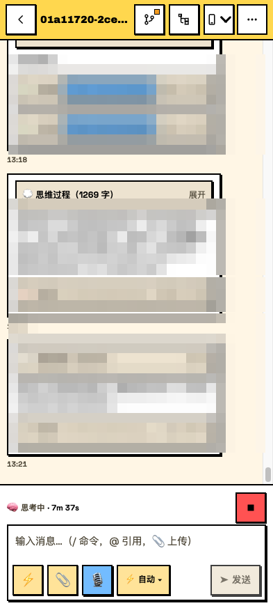
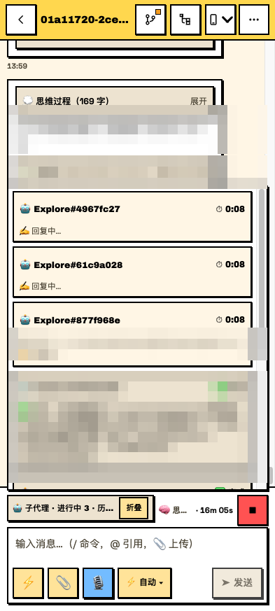
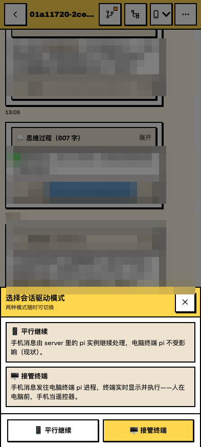
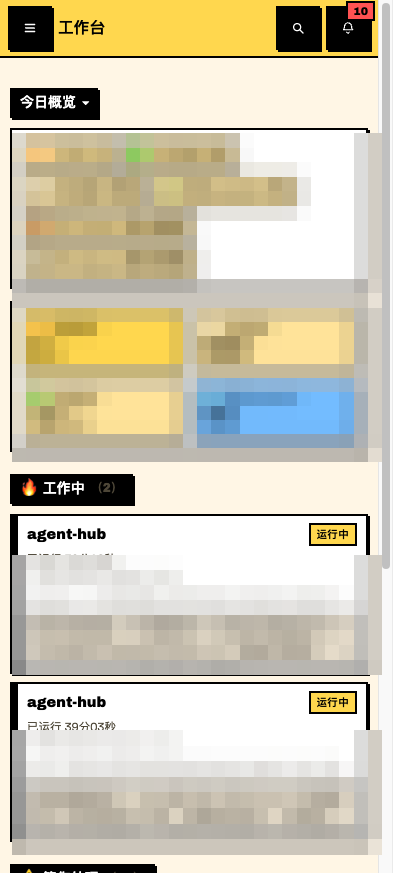

# Agent Hub

[English](README.en.md) | 简体中文

    

> 手机就是电脑的遥控器 + 独立工作台——**自托管**、跨平台（macOS / Linux / Windows）的 **pi / Claude Code / Codex 会话中枢**，数据不出你的机器。

在任何设备的浏览器里打开 PWA 面板 → 一目了然看到全部 agent 会话与工作状态 → 点击进入 chat 界面继续对话、派发任务、实时旁观。会话与终端 CLI 完全互通——会话文件就是唯一事实源（pi `~/.pi/agent/sessions/`、Claude Code `~/.claude/projects/`、Codex `~/.codex/sessions/`）。

## 截图

<p align="center">
  
</p>

| 🗂 工作台首页 | 💬 Chat 工作页 |
|---|---|
|  |  |
| **🤖 多子代理面板** | **📱 双模式驱动 / 🔐 应用锁** |
|  |   |

## 特性

- **🧩 三源会话支持**：pi / Claude Code / Codex 统一列表、详情与驱动（Codex 含桌面 app 会话：工具卡片 / 用量入账 / 归档会话 📦）
- **📱 双模式会话驱动**：🖥 接管终端（pi：消息注入已有终端进程；Claude：hub 新建持续运行的 CLI 进程续接同一会话，支持 tmux 投屏和手机批权限）/ 📱 平行继续（由 server 续接上下文；pi 的工具调用在电脑真实执行且无人工批准，首次进入会明示）。支持 pi / Claude 双模式，Codex 目前仅支持平行模式；默认策略可配置，手动选择优先。电脑终端正在写同一会话时平行发送会被拦下并说明原因（防双写分叉）；模型/网络失败在气泡内给出原文与自救动作。详见下方模式说明。
- **🤖 子代理活动面板**：pi / claude 双源子代理实时展示（当前工具 / 输出摘要 / 运行时长），像终端多 agent 面板
- **🔴 实时旁观**：终端跑的 pi 会话，手机上看思维链、流式回复、工具执行（token 级）
- **🗂 工作台首页**：按注意力组织（🔥工作中 / ⚠️等你处理 / 今日概览），真实数据；今日概览按来源（pi/claude/codex）细分统计，可按来源过滤
- **📈 Token 用量**：今日/7 天/全部 token 与费用汇总，会话级用量徽章
- **💬 Chat 工作页**：阶段化等待反馈、slash 命令、快捷指令模板、@ 文件引用、上传图片、引用回复、代码高亮/复制、GFM 表格、语音输入、草稿自动恢复
- **📊 会话管理**：优先级排序、子代理父子树、全局搜索、分支树、复制会话（fork）、会话改名、来源筛选（pi/claude/codex）
- **🌿 Git 集成**：仓库状态、diff 查看器、工具调用文件联动（只读安全）
- **⚡ 性能**：WS 批处理、消息 memo、长会话窗口化（流式渲染 12-15x、DOM 21x 瘦身）；服务端 brotli 压缩 + hash 产物长缓存（弱网/远程友好）
- **🔔 通知中心**：会话完结横幅/震动/声音、未读聚合、点击即读
- **🔐 应用锁 + 离线队列**：PIN / WebAuthn 通行密钥解锁、断网消息排队自动重发
- **🖥 Web 终端**（ttyd 可选）：面板内直接开真终端
- **🌐 中英双语（i18n）**：界面语言跟随系统 / 中文 / English 一键切换，持久化生效

## 旧会话续聊与发送模式

已经完成的会话仍可继续聊：即使电脑上的原终端已关闭，手机发送新消息也会从保存的上下文开始新一轮工作。只打开会话不会自动重发历史任务；会话名称（如“任务完成状态”）也不代表当前运行状态。执行依赖电脑上的 hub 服务及对应 agent 运行环境；关闭 PWA 不会停止已受理的任务，hub 服务重启不会自动恢复执行或接管。

| Claude 场景 | 发送行为 |
|---|---|
| 平行模式，当前空闲 | hub 启动一次 CLI 续聊，无需原终端保持打开 |
| 平行模式，hub 启动的任务正在运行 | 普通发送返回忙；“插话”和“排队”均在该任务结束后发送 |
| 平行模式，未接管的电脑终端正在运行（pi / Claude） | 三种发送模式均返回忙（pi 为 `EXTERNAL_ACTIVE`，Claude 为 `SESSION_BUSY`），并给出可行动的中文原因；平行模式无法向这个终端排队 |
| 接管模式 | hub 持有新的 CLI 进程；“插话”在工具间隙处理，“排队”在本轮结束后处理；正忙时普通发送通过回执报告失败 |

pi 平行模式由 hub 进程内的 SDK 实例续聊，**工具调用（读写文件、执行命令）在你电脑上真实执行且无人工批准**，请只在你信任的仓库使用；Claude 平行固定 `--permission-mode manual`，需确认的工具一律被拒。模型/网络失败（含余额耗尽、连接中断、上下文溢出）在 pi 里不抛异常而是落在消息的 stopReason 上，hub 会把它透出为气泡内错误条：上下文溢出给「压缩上下文」一键自救，主动中止用中性语气不当报错；错误类提示常驻不自动消失。被双写闸门拦下或终端未执行的消息会退回离线队列并保留失败气泡（含重试入口），文本不会丢。

Claude 接管不会控制原来的 TUI 窗口。接管期间请避免同时在原窗口输入；tmux 仅展示 hub 进程的输出。外部活动检测依赖文件更新时间，静默窗不能替代进程锁。

默认 `active-only` 策略下，pi 终端扩展在线时默认接管；Claude 在状态为 `running` **或** `lastDrivenBy=terminal` 时默认尝试接管，其他情况默认平行。`always` 每次打开均尝试接管，`never` 只手动切换；用户手动选择优先，实际接管仍受静默窗、开关及并发上限约束。

回复中的一条消息结束后，整轮任务可能仍在执行工具。页面以整轮结束事件和服务端状态确认完成，静默 5 秒会补查状态，不会仅凭静默就显示完成。

上传图片通过缩略图展示；Claude 的图片尺寸/坐标提示属于内部元数据，不显示为用户消息。旧的 `@.agent-hub-uploads/...` 历史消息在保存了对应的成功读图结果后可恢复预览；仅有路径、尚未读图的历史记录不保证刷新后有预览。完整约束见 [API 契约](docs/API_CONTRACT.md)和 [Claude 驱动说明](docs/CLAUDE_DRIVER.md)。

## 快速开始

方式一：npm 包（npx / 全局安装）——或直接 git clone（见方式二），两种路径任选：

```bash
npx agent-hub remote        # 一键远程：首次 setup → 使用包内产物启动 + Tailscale
# 或安装后使用完整子命令（dev / setup / start / remote / check / open，doctor 为 check 别名）
npm install -g agent-hub
agent-hub setup             # 检测环境、生成 config
agent-hub remote            # = 首次 setup + start --tailscale；可重复执行
```

方式二：直接 git clone（仓库开发 / 自托管源码）：

```bash
git clone https://github.com/newObjectccc/agent-hub.git
cd agent-hub
npm run dev          # 开发模式一条命令：server 热重载 + web Vite HMR（前端 http://localhost:5173）
npm run start        # 正式启动：装依赖 → 构建 → 启动，默认 http://127.0.0.1:7700
npm run remote       # 一键远程：自动 setup + 构建 + start --tailscale（幂等）
```

> ⚠️ 用 pnpm 时**不要敲 `pnpm setup`**——那是 pnpm 内置命令（配置 pnpm shell 环境用的），不会执行本项目的 setup。需要 setup 时用 `npm run setup` 或 `node cli/setup.js`。另外 `dev` / `start` 在配置缺失时会自动生成默认配置，setup 仅用于环境体检、装 pi 扩展和注册自启。

## 标准集成链路：手机远程让 pi 干活（实测跑通）

> 这是本项目推荐的默认集成方式，已在 macOS + Android 真机上端到端验证：**装 Tailscale → 一条命令 → 手机装真 PWA（无地址栏）→ 随时给电脑上的 pi 派任务**。

### 步骤（全程 10 分钟）

1. **电脑 + 手机装 [Tailscale](https://tailscale.com/download)，登录同一账号**
   个人免费版（3 用户 / 100 设备）即可；手机 App 商店搜 Tailscale，登同一账号并打开连接开关
2. **开启 HTTPS 证书**：[Tailscale Admin Console](https://login.tailscale.com/admin) → HTTPS Certificates → Enable（一次性，签发面板域名证书用）
3. **电脑上一键启动**：

```bash
npm run remote        # = setup + 构建 + start --tailscale，幂等可重复执行
# 等价：node cli/start.js --tailscale；仅局域网用 --lan
```

   成功输出形如：

```
Tailscale Serve 已开启（HTTPS）：https://<node>.<tailnet>.ts.net
手机浏览器打开该地址 → 菜单 →「安装应用」= 无地址栏真 PWA（WebAPK）。
```

4. **手机安装 PWA**：Chrome 打开打印的 `https://…` 地址 → 菜单 →「**安装应用**」（不是「添加到主屏幕」）→ 打开验证：无地址栏、独立窗口、独立任务栈
5. 之后电脑不在身边时：手机打开 PWA → 工作台 → 派任务 / 实时旁观 / chat 续聊

### ⚠️ 延迟警告：先体检 P2P 直连（延迟敏感用户必读）

手机远程的体验**完全取决于链路走 P2P 直连还是 DERP 中继**：

| 链路 | 延迟 | 体验 |
|---|---|---|
| ✅ P2P 直连（IPv6 / UDP 打洞成功） | < 50ms | 秒开、流式丝滑 |
| ❌ DERP 中继（打洞失败的兜底） | 300ms+ | 明显卡慢——首屏几十个 API/WS 往返，延迟逐级放大 |

部署完先跑一条命令体检（输出「链路延迟体检」一节）：

```bash
agent-hub check              # 等价手动：tailscale netcheck
```

三个关键指标与预期值：

| 指标 | 健康值 | 不健康时怎么做 |
|---|---|---|
| `IPv6` | `yes` | `no` → 路由器启用 IPv6 + 防火墙放行入站 UDP 41641（**首选：v6 无 NAT，免打洞直连**） |
| `MappingVariesByDestIP` | `false` | `true` = 对称 NAT 打洞难 → 路由器开 UPnP；手机蜂窝网络常见，换 Wi-Fi 或用蜂窝 IPv6 出口 |
| `PortMapping` | `UPnP` / `NAT-PMP` | 空 → 路由器开 UPnP，或手动端口转发 UDP 41641 到电脑 |

另看 `Nearest DERP`：正常应为香港/东京（30-50ms）；若显示海外节点且 200ms+（国际链路绕路），打洞失败时会非常慢——务必配好上述直连条件，兜底可自建国内 DERP。

验证直连成功（手机连上 Tailscale 后在电脑执行）：

```bash
tailscale ping <手机的 Tailscale IP>    # 出现 direct（UDPv6）= P2P 直连已打通
```

> 💡 同一 Wi-Fi 下无需 Tailscale：`npm run start -- --lan` 直连局域网 IP，永远最快。

### 已知问题（实测踩坑记录）

| 现象 | 解法 |
|---|---|
| macOS 执行 serve 报 `GUI failed to start` / `CLIError error 3` | GUI 桥失效，root 可直连守护进程：`sudo tailscale serve --bg --https=443 http://127.0.0.1:7700`（实测有效；CLI 诊断失败时也会提示此命令） |
| PWA 装出来带地址栏 / 只是快捷方式 | 当前是 HTTP 源（如自建 headscale），Chrome 只会生成主屏幕快捷方式；换 HTTPS 源重装即解 |
| serve 报证书错误 | Admin Console 的 HTTPS Certificates 未开启（见步骤 2） |
| 手机打开地址超时 | 手机 Tailscale 未连接，或两端登的不是同一账号 |
| 手机能打开但非常慢 | 大概率走 DERP 中继（打洞失败）：跑 `agent-hub check` 体检，按上方「⚠️ 延迟警告」逐条优化 |

> 💡 PWA 冷知识：只有 **HTTPS 源**才能装成真 WebAPK（无地址栏独立窗口），与 manifest 配置无关。官方 Tailscale 的 serve 自动签证书就是为此服务的。

**替代路径**：自建 headscale 控制面见 [docs/HEADSCALE.md](docs/HEADSCALE.md)（tailnet 内 HTTP，PWA 降级）；纯局域网用 `--lan`。详见 [docs/PLATFORM.md](docs/PLATFORM.md)（三平台安装细则）。

## 架构

```
手机 PWA ──HTTP/WS──▶ server (Fastify) ──▶ pi SDK / claude CLI / codex CLI
                          │                    │
                     终端增强层              会话文件（唯一事实源）
                  （tmux/ttyd/Tailscale）   （pi ~/.pi/agent/sessions、
                                            claude ~/.claude/projects、
                                            codex ~/.codex/sessions）
```

| 目录 | 说明 |
|---|---|
| `server/` | REST + WS、pi/claude/codex 三源适配、KPI/通知/git/终端集成 |
| `web/` | PWA（React + Vite + Tailwind v4，野兽派紧凑 UI） |
| `cli/` | 跨平台 dev/setup/start/remote/check/open（纯 Node 零 bash 依赖） |
| `integrations/` | pi 扩展（live-feed 实时流出 / pi-command 反向指令）、Claude 权限 MCP bridge |
| `docs/` | API 契约、架构、平台细则、headscale 自建指南（HEADSCALE.md）、路线图 |
| `docs/headscale/` | 自建 headscale 控制面部署文件（docker compose + Caddy 自动 HTTPS） |

## 文档地图

| 文档 | 内容 |
|---|---|
| [docs/API_CONTRACT.md](docs/API_CONTRACT.md) | REST / WS API 契约（二次开发/集成参考） |
| [docs/ARCHITECTURE.md](docs/ARCHITECTURE.md) | 架构设计与数据流（会话文件为唯一事实源） |
| [docs/CLAUDE_DRIVER.md](docs/CLAUDE_DRIVER.md) | Claude 接管、权限、发送模式与已知限制 |
| [docs/PLATFORM.md](docs/PLATFORM.md) | 三平台（macOS / Linux / Windows）安装细则 |
| [docs/HEADSCALE.md](docs/HEADSCALE.md) | 自建 headscale 控制面（不依赖官方 Tailscale） |
| [docs/ROADMAP.md](docs/ROADMAP.md) | 路线图（规划中） |
| [CHANGELOG.md](CHANGELOG.md) | 版本记录 |
| [CONTRIBUTING.md](CONTRIBUTING.md) | 贡献流程与开发约定 |

## 开发

```bash
pnpm install
pnpm dev                           # 一条命令开发调试（推荐）
#   server:tsc  tsc --watch 增量编译
#   server      node --watch 热重启（改后端代码自动生效）
#   web         Vite HMR（改前端代码即时生效）
pnpm build && pnpm lint && pnpm test   # 全量验证（1500+ 测试，GitHub Actions CI 守护）
```

注意：开发调试入口是 Vite（默认 `http://localhost:5173`），`/api` `/ws` 已代理到 server（默认 7700）；不是直接访问 7700。

若当前工作区正在提供手机服务，请在独立 worktree 中做上述构建验证，避免构建过程改写正在托管的 `web/dist`。发布构建与重启由单一流程执行，见贡献指南。

贡献流程见 [CONTRIBUTING.md](CONTRIBUTING.md)；版本记录见 [CHANGELOG.md](CHANGELOG.md)。

## 部署

本机常驻（推荐平台自启机制）：

```bash
npm run setup -- --autostart   # macOS launchd / Linux systemd / Windows 任务计划
npm run start                  # 前台正式启动（构建 + 启动，配置缺失自动生成）
```

注册后开机自动启动，无需手动操作。检测到 tailscale 时自启命令自动携带 `--tailscale`（开机自动确保 Tailscale Serve，手机远程开箱即连；纯局域网用 `setup -- --autostart --lan` 覆盖）。日常运维：

| 操作 | macOS（launchd） | Linux（systemd --user） |
|---|---|---|
| 停止 | `launchctl unload ~/Library/LaunchAgents/com.agent-hub.plist` | `systemctl --user stop agent-hub` |
| 启动 | `launchctl load ~/Library/LaunchAgents/com.agent-hub.plist` | `systemctl --user start agent-hub` |
| 日志 | `~/Library/Logs/agent-hub.log` | `journalctl --user -u agent-hub` |

> 💡 崩溃自愈：新生成的 launchd 配置默认 `KeepAlive=true`，进程退出后会自动拉起。已有旧配置先用上表的 unload，再重新运行 `npm run setup -- --autostart`，让 launchd 读取新配置；主动停止也用 unload。服务重启保留历史，但不会自动续跑任务。

服务器（pm2，崩溃自愈 + 开机自启）：

```bash
pnpm build
pm2 start ecosystem.config.js
pm2 save && pm2 startup        # 开机自启
```

## 配置

- `config/hub.config.json`：端口/目录/鉴权（setup 生成），字段与默认值：

| 字段 | 默认 | 说明 |
|---|---|---|
| `port` | `7700` | 面板端口 |
| `host` | `127.0.0.1` | 监听地址（拒绝通配绑定，见安全须知） |
| `sessionDir` | `~/.pi/agent/sessions` | pi 会话目录（支持 `~`，下同） |
| `workspaceRoot` | `~/Workspace` | 工作区根目录（今日概览 git 统计 / 上传与新建会话 cwd 的约束根） |
| `kpiRefreshMinutes` | `5` | 指标卡后台刷新间隔（分钟） |
| `auth` | `{"enabled": false, "token": ""}` | API / WS 鉴权（见安全须知） |
| `allowOrigins` | `[]` | 跨域白名单（精确 origin，如 `https://app.example.com`；空数组 = 拒绝一切跨域） |
| `allowLan` | `false` | 显式开启局域网暴露（允许 `host` 通配绑定；`start --lan` 会自动写入） |
| `claudeDriver.enabled` | `true` | claude 接管（hub 驱动）总开关：关掉后不构造驱动、接管接口回 400，前端回落平行模式 |
| `claudeDriver.defaultPolicy` | `"active-only"` | 默认接管策略：Claude `running` 或最后由终端驱动时尝试接管 / `always`=打开即尝试 / `never`=只手动；pi 还要求扩展在线，手动选择优先 |
| `claudeDriver.idleDetachMs` | `1800000` | 空闲自动退出接管（毫秒，30 分钟；`0`=永不，运行中不退） |
| `claudeDriver.maxConcurrent` | `3` | 并发 hub 驱动上限，含正在准备的接管（超出 409 DRIVER_LIMIT） |
| `claudeDriver.mirror` | `"tmux"` | 终端投屏（tmux 命名 session，`tmux attach` 实时观看；无 tmux 自动降级 `off`） |
| `claudeDriver.externalQuietMs` | `3000` | 接管准备前及启动进程前各检查一次文件静默窗；近期外部写入返回 409，无法提供进程级互斥 |

- `config/kpi-sources.json`：可选指标卡数据源（`${ENV_VAR}` 引用密钥）

## 安全须知（部署前必读）

本项目默认**零鉴权**，信任边界是你的私有网络——部署形态决定安全性：

| 部署形态 | 安全 | 需要做什么 |
|---|---|---|
| 本机 `127.0.0.1`（默认） | ✅ | 无 |
| Tailscale / headscale / 私有局域网 | ✅ | 无（推荐形态） |
| 公网 VPS / 公网 IP 直接暴露 | ❌ | **必须**开启 `auth.token`（见下），否则任何能访问到端口的人都能驱使你机器上的 pi/Claude agent 执行指令 |

- **开启 API 鉴权**：`config/hub.config.json` 里 `"auth": { "enabled": true, "token": "<长随机串>" }`——开启后全部 API 与 WS 均需 `Authorization: Bearer <token>`
- `auth.enabled` 默认 `false` 是刻意设计（tailnet 内免 token 的顺手体验）；暴露公网前请务必开启
- **应用锁（PIN / WebAuthn）**保护界面，并在服务端校验业务 HTTP 请求和 WS 发送/中止的解锁令牌；它不能替代 API token，两层可同时启用
- `host` 默认 `127.0.0.1` 且拒绝通配绑定；局域网开放需显式 `"allowLan": true`（或 `agent-hub start --lan` / `npm run start -- --lan`，CLI 会自动写入 `allowLan`）
- 发现安全问题请**勿公开 issue**，通过仓库 About 页的联系方式私下告知

## License

[MIT](LICENSE) © 2026 newObjectccc
