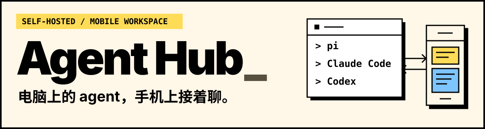
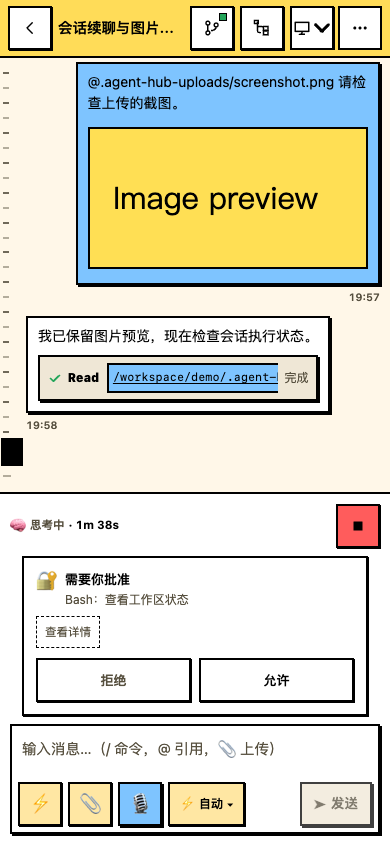
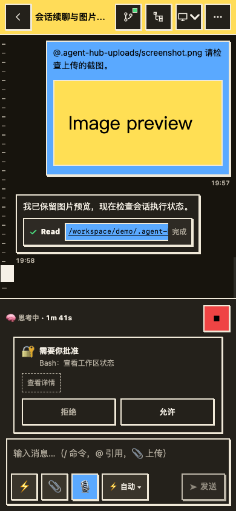
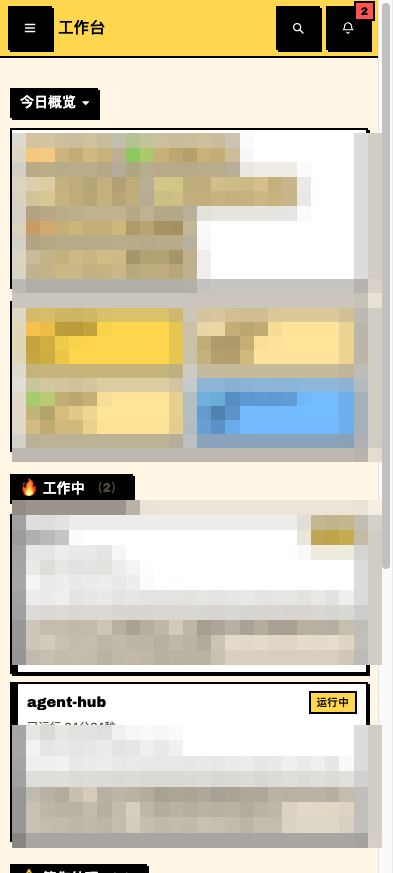
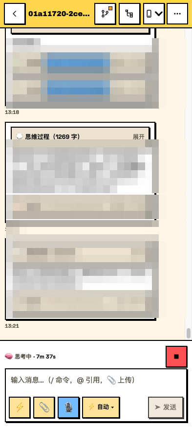
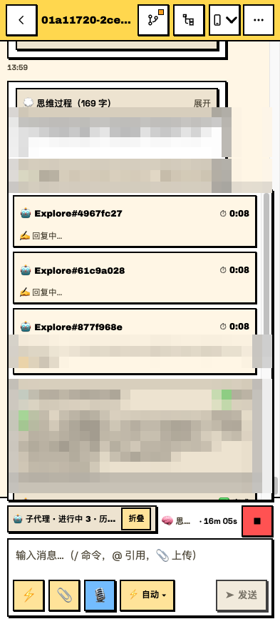
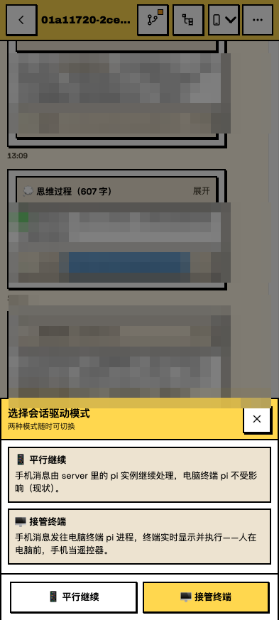

# Agent Hub

[English](README.en.md) · 简体中文

[](https://github.com/newObjectccc/agent-hub-public/actions/workflows/ci.yml) [](https://www.npmjs.com/package/@newobjectcccddd/agent-hub) [](LICENSE)

<p align="center">
  
</p>

**在手机上查看、继续和管理电脑上的 pi / Claude Code / Codex 会话。**

Agent Hub 是一个自托管的移动工作台：打开浏览器就能看进度、接着聊、派发任务，并处理 agent 发来的问答和权限请求。支持 macOS、Linux、Windows；可安装为 PWA，界面支持中文与 English。

[快速开始](#快速开始) · [能做什么](#能做什么) · [支持与边界](#支持与边界) · [文档](#文档)

**阅读提示：完整参考信息保留在各节的「展开…」中，默认折叠。点击即可在本页查看安装细节、完整功能、发送规则、配置与运维命令；也可通过[使用与运维](docs/USAGE.md)单独阅读。**

## 看看界面

| 浅色 | 深色 |
| :---: | :---: |
| <a href="docs/screenshots/claude-v03-390-light.png"></a> | <a href="docs/screenshots/claude-v03-390-dark.png"></a> |

Claude 示例会话展示图片预览、工具卡片与需确认权限档位下的手机审批。点击查看原图；不同 agent 的能力见[支持与边界](#支持与边界)。

<details>
<summary>展开完整演示与截图：工作台、聊天、子代理、模式选择与应用锁</summary>

### 截图

<p align="center">
  
</p>

| 🗂 工作台首页 | 💬 Chat 工作页 |
|---|---|
|  |  |
| **🤖 多子代理面板** | **📱 双模式驱动 / 🔐 应用锁** |
|  |   |

</details>

## 快速开始

电脑需要 **Node.js ≥22.19**，以及已安装、登录并能正常对话的 **pi / Claude Code / Codex 中至少一种**。npm 包自带前后端产物，无需 Git、pnpm 或本地构建。

```bash
npm install -g @newobjectcccddd/agent-hub@beta --registry=https://registry.npmjs.org/
agent-hub start
```

在电脑打开 **[http://127.0.0.1:7700](http://127.0.0.1:7700)**，选择一条已有会话，发送一条小任务并确认回复。没有历史会话时，先在电脑的 agent CLI 中建立一条，再刷新工作台。

请使用完整作用域包名；裸名 `agent-hub` 是另一个项目。临时试用可用 `npx --registry=https://registry.npmjs.org/ @newobjectcccddd/agent-hub@beta start`。上述命令只为本次安装指定 npm 官方源。

### 从手机连接

先停止当前前台实例，再选择一种连接方式：

- **跨网络，推荐 Tailscale**：电脑和手机安装并登录 Tailscale，电脑运行 `agent-hub remote`。首次按提示授权 MagicDNS / HTTPS；看到 **“Tailscale Serve 已开启（HTTPS）”** 后，在手机打开打印的 `https://<node>.<tailnet>.ts.net` 地址。
- **同一可信局域网**：电脑运行 `agent-hub start --lan`，手机打开 `http://<电脑的局域网 IP>:7700`。HTTP 下 PWA 安装与部分浏览器能力受限。
- **已有自建网络或反向代理**：沿用自己的网络与鉴权配置，参见 [Headscale 指南](docs/HEADSCALE.md)与[安全说明](SECURITY.md)。

Tailscale 是可选的远程方案。使用期间，电脑需要保持开机、联网，Hub 和对应 agent 运行环境需要可用。Android Chrome 可使用安装入口；iPhone Safari 使用“分享 → 添加到主屏幕”。

**执行权限**：默认情况下，pi 直接执行工具，Claude 使用 `bypassPermissions`，Codex 使用 `never` + `danger-full-access`。发送任务可能在电脑上自动读写文件、执行命令；请先了解[权限配置与发送行为](docs/USAGE.md)。

需要常驻时，先停止前台实例，再用全局安装执行 `agent-hub setup --autostart`；诊断用 `agent-hub check`。完整步骤与故障处理见[安装指南](docs/INSTALL.md)。

<details>
<summary>展开完整安装步骤：npm / npx、配置保留、Tailscale 授权与源码启动</summary>

### 快速开始（npm Beta）

Beta.3 起，若终端 pi 切到 Grok 能用、手机新建 pi 却报模型服务的 403，在新建表单选择 `xai / grok-4.5`，或打开已有会话，在输入框上方点“切换模型”，选择后手动重试失败消息。终端 `/model` 中 **Enter 只切当前会话，Ctrl+S 才保存默认值**；Hub 不会把终端当前临时选择当成新会话默认值。运行中或终端仍持有该会话时，先结束任务并退出终端会话。列表来自 Hub 所在用户和环境的 pi 配置，实际额度与服务权限仍由 provider 决定；详细排查见 [安装指南](docs/INSTALL.md#pi-模型与-403-排查)。

电脑准备 **Node.js ≥22.19（自带 npm）**，并先在电脑上安装、登录你要使用的 **pi / Claude Code / Codex 中至少一种**。Hub 复用本机 agent 的登录与模型设置；不必把三种 CLI 全装一遍。电脑需要保持开机、联网，Hub 服务也需要持续运行。

推荐全局安装，便于长期使用和注册自启动；npm 包自带前后端产物，**不需要 Git、pnpm 或现场构建**：

```bash
npm install -g @newobjectcccddd/agent-hub@beta --registry=https://registry.npmjs.org/
agent-hub remote
```

只想临时试用，也可以执行 `npx --registry=https://registry.npmjs.org/ @newobjectcccddd/agent-hub@beta remote`。上述命令仅对本次指定 npm 官方源，不修改已有的公司源设置。裸名 `agent-hub` 是无关第三方包，请使用完整作用域。npm 包与 npx 共用 `~/.agent-hub/config/hub.config.json` 和 `~/.agent-hub/data/`，更换版本或清理 npx 缓存不会删除配置、应用锁和运行状态。

首次 `remote` 会生成配置、按需安装 pi 终端扩展，并尝试配置 Tailscale Serve；之后可重复执行。**Tailscale 是推荐的可选远程方案，不是 Hub 的必装依赖。**

| 使用方式 | 启动命令 | 需要准备 |
|---|---|---|
| 电脑本机 | `agent-hub start` | 默认地址 `http://127.0.0.1:7700`，无需 Tailscale |
| 可信局域网 | `agent-hub start --lan` | 手机与电脑在同一局域网；HTTP 下 PWA 安装能力受限 |
| 跨网络远程（推荐） | `agent-hub remote` | 电脑、手机安装并登录 Tailscale |
| 自建网络 / 反向代理 | `agent-hub start` | 沿用自己的网络与鉴权配置，参见 [安全说明](SECURITY.md) 与 [Headscale 指南](docs/HEADSCALE.md) |

从 `0.3.0-beta.2` 起，`remote` 支持 `--lan`、`--no-tailscale`，自启可用 `setup --autostart --no-tailscale` 跳过自动检测；npm `0.3.0-beta.1` 使用上表的 `start` 命令选择本机或局域网。

#### 电脑和手机通过 Tailscale 接入

1. 选择此推荐方案时，两端安装 [Tailscale](https://tailscale.com/download)，登录同一账号、连接同一 tailnet。电脑需要可用的 Tailscale CLI；Beta.2 起还会识别 macOS App 内置 CLI 与 Windows 默认安装路径。若你配置过 ACL，还需允许手机访问这台电脑。
2. 首次使用 Serve 需要开启 MagicDNS / HTTPS 证书。按 CLI 打印的授权地址完成确认，或在管理后台的 DNS 页开启；参见 [Tailscale Serve 官方说明](https://tailscale.com/docs/features/tailscale-serve)。
3. 电脑运行 `agent-hub remote`。看到 **“Tailscale Serve 已开启（HTTPS）”** 和 `https://<node>.<tailnet>.ts.net` 才表示远程入口已建立。
4. 手机浏览器打开该 HTTPS 地址。Android Chrome 使用安装入口；iPhone Safari 使用“分享 → 添加到主屏幕”。首次打开可设置应用锁，再进入工作台选择会话。
5. 发送一条小任务，确认对应 agent 真正回复。若没有历史会话，可先在电脑的 agent CLI 中建立一条会话，再刷新工作台。

账号登录、HTTPS 授权和手机系统确认由使用者本人完成；其余安装、配置、启动可交给自己的 agent。仅让两端登录同一账号，还不等于 Hub 与 HTTPS Serve 已启动。

需要长期常驻时，先用 Ctrl+C 停止前台实例，再运行 `agent-hub setup --autostart`；避免同时启动两份服务。不要在临时 npx 安装目录注册自启，请使用全局安装。日常诊断用 `agent-hub check`。更完整的逐项验收与故障处理见 [新电脑安装指南](docs/INSTALL.md)。

#### 从源码运行

源码开发需要 Git 和 pnpm 10；下面启动方式选择一种即可：

```bash
git clone https://github.com/newObjectccc/agent-hub-public.git
cd agent-hub-public
npm install -g pnpm@10
pnpm install --frozen-lockfile
node cli/setup.js
npm run start
```

手机远程把最后一行换为 `npm run remote`；开发热更新用 `npm run dev`（前端 `http://localhost:5173`）。不要同时启动多种模式。`pnpm setup` 是 pnpm 自带命令，需要本项目 setup 时用 `node cli/setup.js`。

Beta 的本机与 CI 验证范围见 [安装指南](docs/INSTALL.md)。Codex 手机审批三类卡片已接线，真实命令/文件/permissions 审批闭环仍待分别验收；版本和能力边界见 [Codex 驱动说明](docs/CODEX_DRIVER.md)。

</details>

## 能做什么

- **看清哪些会话需要你**：统一查看三种 agent 的会话、运行状态与未读消息，按来源筛选、搜索、改名或 fork 会话。
- **离开电脑也能接着工作**：从保存的上下文继续对话；选择平行继续或接管模式，查看流式回复与工具执行。
- **在手机上交代清楚任务**：上传图片、引用文件和消息，使用快捷指令、slash 命令与语音输入；输入草稿自动恢复。
- **跟踪多 agent 工作**：查看 pi / Claude 子代理的当前工具、输出摘要与运行时间；查看 token 与费用统计，以及只读 Git 状态和 diff。
- **处理需要你决定的事**：接收完成通知、回答模型问题，在所用 agent 的权限策略需要时处理审批。
- **按自己的习惯使用**：深浅色与中英界面、PIN / WebAuthn 应用锁、离线消息队列；可选接入 ttyd Web 终端。
- **选择 pi 会话模型（Beta.3）**：新建会话时选择已配置的 provider/model，空闲时可切换已有会话的模型。保留上下文，不改全局默认值。[模型与 403 排查](docs/INSTALL.md#pi-模型与-403-排查)

<details>
<summary>展开完整功能清单与各 agent 的能力细节</summary>

### 特性

- **🧩 三源会话支持**：pi / Claude Code / Codex 统一列表、详情与驱动（Codex 含桌面 app 会话：工具卡片 / 用量入账 / 归档会话 📦）
- **📱 双模式会话驱动**：🖥 接管终端（pi：消息注入已有终端进程；Claude：hub 新建持续运行的 CLI 进程续接同一会话，支持 tmux 投屏；非 bypass 档位可手机批权限，默认 bypass 档位全自动）/ 📱 平行继续（由 server 续接上下文；pi 的工具调用在电脑真实执行且无人工批准，首次进入会明示）。三源均支持双模式，Codex 进入会话默认 📱 平行继续（2026-10-23 产品规则：接管有「须先退出电脑端桌面会话」的写者互斥前提，与 pi/claude 活跃会话默认接管刻意不同），接管需手动切换，支持原生插话/中止、手机审批（三类卡片已接线，真实审批闭环待验）与工具交互问答（`requestUserInput`/elicitation 走手机问答卡片，选项/自由文本作答，不代答）与图片（不控制原桌面窗口）；默认策略可配置，手动选择优先。电脑终端正在写同一会话时平行发送会被拦下并说明原因（防双写分叉）；模型/网络失败在气泡内给出原文与自救动作。详见下方模式说明。
- **🤖 子代理活动面板**：pi / claude 双源子代理实时展示（当前工具 / 输出摘要 / 运行时长），像终端多 agent 面板
- **🔴 实时旁观**：终端跑的 pi 会话，手机上看思维链、流式回复、工具执行（token 级）
- **🗂 工作台首页**：按注意力组织（🔥工作中 / ⚠️等你处理 / 今日概览），真实数据；今日概览按来源（pi/claude/codex）细分统计，可按来源过滤
- **📈 Token 用量**：今日/7 天/全部 token 与费用汇总，会话级用量徽章
- **💬 Chat 工作页**：阶段化等待反馈、slash 命令、快捷指令模板、@ 文件引用、上传图片、引用回复、代码高亮/复制、GFM 表格、语音输入、草稿自动恢复
- **📊 会话管理**：优先级排序、子代理父子树、全局搜索、分支树、复制会话（fork）、会话改名、来源筛选（pi/claude/codex）
- **🎛 pi 模型选择**：新建时选择本机已配置的 provider/model，已有会话显示当前模型并支持空闲时切换；保留上下文，不改全局默认值。
- **🌿 Git 集成**：仓库状态、diff 查看器、工具调用文件联动（只读安全）
- **⚡ 性能**：WS 批处理、消息 memo、长会话窗口化（流式渲染 12-15x、DOM 21x 瘦身）；服务端 brotli 压缩 + hash 产物长缓存（弱网/远程友好）
- **🔔 通知中心**：会话完结横幅/震动/声音、未读聚合、点击即读
- **🔐 应用锁 + 离线队列**：PIN / WebAuthn 通行密钥解锁、断网消息排队自动重发
- **🖥 Web 终端**（ttyd 可选）：面板内直接开真终端
- **🌐 中英双语（i18n）**：界面语言跟随系统 / 中文 / English 一键切换，持久化生效

</details>

## 如何工作

```text
手机 / 浏览器  ⇄  你电脑上的 Agent Hub  ⇄  pi / Claude Code / Codex
                     HTTP + WebSocket           本机运行环境与会话文件
```

Hub 复用本机 agent 的登录、模型配置与会话记录，三种 CLI 不必全部安装。会话文件仍是事实源：pi 在 `~/.pi/agent/sessions/`，Claude 在 `~/.claude/projects/`，Codex 在 `~/.codex/sessions/`。Hub 与会话记录由你自行托管；模型请求仍按所选 agent 和 provider 的配置发送。

<details>
<summary>展开架构图与仓库目录说明</summary>

### 架构

```
手机 PWA ──HTTP/WS──▶ server (Fastify) ──▶ pi SDK / claude CLI / codex CLI
                          │                    │
                     终端增强层              会话文件（唯一事实源）
                  （tmux/ttyd/Tailscale）   （pi ~/.pi/agent/sessions、
                                            claude ~/.claude/projects、
                                            codex ~/.codex/sessions）
```

| 目录 | 说明 |
|---|---|
| `server/` | REST + WS、pi/claude/codex 三源适配、KPI/通知/git/终端集成 |
| `web/` | PWA（React + Vite + Tailwind v4，野兽派紧凑 UI） |
| `cli/` | 跨平台 dev/setup/start/remote/check/open（纯 Node 零 bash 依赖） |
| `integrations/` | pi 扩展（live-feed 实时流出 / pi-command 反向指令）、Claude 权限 MCP bridge |
| `docs/` | API 契约、架构、平台细则、headscale 自建指南（HEADSCALE.md）、路线图 |
| `docs/headscale/` | 自建 headscale 控制面部署文件（docker compose + Caddy 自动 HTTPS） |

</details>

## 支持与边界

- **pi**：支持平行续聊与终端扩展接管；扩展在线时可实时旁观。工具调用会在电脑上实际执行。
- **Claude Code**：接管时 Hub 新建 CLI 进程续接同一会话，可用 tmux 查看该进程。它不会控制原来的 TUI 窗口；平行与接管都按配置的权限档位运行。[Claude 驱动说明](docs/CLAUDE_DRIVER.md)
- **Codex**：可读取桌面 App 会话；默认平行继续，接管需手动切换并先退出电脑上正在写同一会话的客户端。接管要求 Codex CLI ≥0.162（含对应 alpha）。问答与审批卡片已接线，真实命令、文件和 permissions 审批闭环仍待分别验收。[Codex 驱动说明](docs/CODEX_DRIVER.md)
- **会话持续性**：原终端关闭后可从保存的历史续聊；关闭手机页面不会停止已受理的工作。重启 Hub 保留历史，但不会自动续跑任务或恢复接管。避免两端同时写入同一会话。
- **部署边界**：默认仅监听本机、未启用 API 鉴权。远程使用可信私网或带鉴权的反向代理，勿直接暴露到公网。应用锁与 API token 各有用途；当前内置 PWA 不支持输入 Bearer token，不能只靠 `auth.token` 配置公网访问。[安全策略](SECURITY.md) · [完整配置](docs/USAGE.md#配置)
- **验证范围**：macOS / Linux 的本机与 CI 记录见安装指南；Windows 原生和真实跨设备链路仍需在目标环境验收。

<details>
<summary>展开完整会话规则：发送行为表、默认模式、权限与失败处理</summary>

### 旧会话续聊与发送模式

已经完成的会话仍可继续聊：即使电脑上的原终端已关闭，手机发送新消息也会从保存的上下文开始新一轮工作。只打开会话不会自动重发历史任务；会话名称（如“任务完成状态”）也不代表当前运行状态。执行依赖电脑上的 hub 服务及对应 agent 运行环境；关闭 PWA 不会停止已受理的任务，hub 服务重启不会自动恢复执行或接管。

| Claude 场景 | 发送行为 |
|---|---|
| 平行模式，当前空闲 | hub 启动一次 CLI 续聊，无需原终端保持打开 |
| 平行模式，hub 启动的任务正在运行 | 普通发送返回忙；“插话”和“排队”均在该任务结束后发送 |
| 平行模式，未接管的电脑终端正在运行（pi / Claude） | 三种发送模式均返回忙（pi 为 `EXTERNAL_ACTIVE`，Claude 为 `SESSION_BUSY`），并给出可行动的中文原因；平行模式无法向这个终端排队 |
| 接管模式 | hub 持有新的 CLI 进程；“插话”在工具间隙处理，“排队”在本轮结束后处理；正忙时普通发送通过回执报告失败 |

pi 平行模式由 hub 进程内的 SDK 实例续聊，**工具调用（读写文件、执行命令）在你电脑上真实执行且无人工批准**，请只在你信任的仓库使用；Claude 平行默认 `--permission-mode bypassPermissions`：工具在你电脑上**自动执行且无人工批准**（与 pi 同类风险，请只在信任的仓库使用），可在 hub 配置 `claudeDriver.permissionMode` 改回 `manual` 等需确认档位——需确认档位下平行与接管两路径都会在手机上弹出审批卡片（同一套 HostRequestCard，允许/拒绝后继续）。模型/网络失败（含余额耗尽、连接中断、上下文溢出）在 pi 里不抛异常而是落在消息的 stopReason 上，hub 会把它透出为气泡内错误条：上下文溢出给「压缩上下文」一键自救，主动中止用中性语气不当报错；错误类提示常驻不自动消失。被双写闸门拦下或终端未执行的消息会退回离线队列并保留失败气泡（含重试入口），文本不会丢。

Codex 两条通道同样默认最高执行权限：免操作审批、完整文件与网络访问。权限只作用于 Hub 驱动的 agent 进程，沿用当前系统账号能力；模型向你提问时仍会等待问答卡片。已有配置中的显式 `inherit` 或收紧档位会继续保留，升级不会覆盖你的选择。

Claude 接管不会控制原来的 TUI 窗口。接管期间请避免同时在原窗口输入；tmux 仅展示 hub 进程的输出。外部活动检测依赖文件更新时间，静默窗不能替代进程锁。

默认 `active-only` 策略下，pi 终端扩展在线时默认接管；Claude 在状态为 `running` **或** `lastDrivenBy=terminal` 时默认尝试接管，其他情况默认平行。`always` 每次打开均尝试接管，`never` 只手动切换；用户手动选择优先，实际接管仍受静默窗、开关及并发上限约束。

回复中的一条消息结束后，整轮任务可能仍在执行工具。页面以整轮结束事件和服务端状态确认完成，静默 5 秒会补查状态，不会仅凭静默就显示完成。

上传图片通过缩略图展示；Claude 的图片尺寸/坐标提示属于内部元数据，不显示为用户消息。旧的 `@.agent-hub-uploads/...` 历史消息在保存了对应的成功读图结果后可恢复预览；仅有路径、尚未读图的历史记录不保证刷新后有预览。完整约束见 [API 契约](docs/API_CONTRACT.md)和 [Claude 驱动说明](docs/CLAUDE_DRIVER.md)。

</details>

<details>
<summary>展开完整配置表与安全说明：默认值、API 鉴权、应用锁与公网限制</summary>

### 配置

- npm 使用 `~/.agent-hub/config/hub.config.json`，源码仓使用 `config/hub.config.json`：端口/目录/鉴权（setup 生成），字段与默认值：

| 字段 | 默认 | 说明 |
|---|---|---|
| `port` | `7700` | 面板端口 |
| `host` | `127.0.0.1` | 监听地址（拒绝通配绑定，见安全须知） |
| `sessionDir` | `~/.pi/agent/sessions` | pi 会话目录（支持 `~`，下同） |
| `workspaceRoot` | `~/Workspace` | 工作区根目录（今日概览 git 统计 / 上传与新建会话 cwd 的约束根） |
| `kpiRefreshMinutes` | `5` | 指标卡后台刷新间隔（分钟） |
| `auth` | `{"enabled": false, "token": ""}` | API / WS 鉴权（见安全须知） |
| `allowOrigins` | `[]` | 跨域白名单（精确 origin，如 `https://app.example.com`；空数组 = 拒绝一切跨域） |
| `allowLan` | `false` | 显式开启局域网暴露（允许 `host` 通配绑定；`start --lan` 会自动写入） |
| `codexBin` | `"codex"` | CLI 命令或绝对路径，parallel/接管共用；doctor 显示实际版本，接管要求 0.162+（含对应 alpha） |
| `codexDriver.enabled` / `defaultPolicy` | `true` / `"never"` | 默认平行继续，Codex 接管仅手动；此项不控制工具权限，详见 [驱动说明](docs/CODEX_DRIVER.md) |
| `codexDriver.approvalPolicy` / `sandbox` | `"never"` / `"danger-full-access"` | 同时控制平行与接管，默认免操作审批、完整文件和网络访问（以当前系统账号与管理员策略为界）。可选审批 `inherit\|never\|untrusted\|on-request`、沙箱 `inherit\|danger-full-access\|read-only\|workspace-write`；`inherit` 才沿用本机配置。接管核对实际回显，非法权限字段拒绝启动。需要手机审批可选 `on-request`（由模型申请时提示）；`untrusted` 取决于 CLI 版本支持，真实审批闭环仍需实测 |
| `claudeDriver.enabled` | `true` | claude 接管（hub 驱动）总开关：关掉后不构造驱动、接管接口回 400，前端回落平行模式 |
| `claudeDriver.defaultPolicy` | `"active-only"` | 默认接管策略：Claude `running` 或最后由终端驱动时尝试接管 / `always`=打开即尝试 / `never`=只手动；pi 还要求扩展在线，手动选择优先 |
| `claudeDriver.idleDetachMs` | `1800000` | 空闲自动退出接管（毫秒，30 分钟；`0`=永不，运行中不退） |
| `claudeDriver.maxConcurrent` | `3` | 并发 hub 驱动上限，含正在准备的接管（超出 409 DRIVER_LIMIT） |
| `claudeDriver.mirror` | `"tmux"` | 终端投屏（tmux 命名 session，`tmux attach` 实时观看；无 tmux 自动降级 `off`） |
| `claudeDriver.externalQuietMs` | `3000` | 接管准备前及启动进程前各检查一次文件静默窗；近期外部写入返回 409，无法提供进程级互斥 |
| `claudeDriver.permissionMode` | `"bypassPermissions"` | 权限档位，同时管平行与接管两路径的 `--permission-mode`：默认 `bypassPermissions`（最高权限，两路径工具均自动执行、无人工审批）；`manual`/`default`/`acceptEdits`/`plan` = 需确认档位——平行与接管两路径都走手机审批卡片（同一套 UI）；`inherit` = 沿用你的 `~/.claude/settings.json`。非法权限值、未知键或错放字段会拒绝启动，避免回落最高权限 |

- npm 可在 `~/.agent-hub/config/kpi-sources.json` 创建可选指标卡数据源；源码仓使用 `config/kpi-sources.json`（`${ENV_VAR}` 引用密钥）

### 安全须知（部署前必读）

本项目默认**零鉴权**，信任边界是你的私有网络——部署形态决定安全性：

| 部署形态 | 安全 | 需要做什么 |
|---|---|---|
| 本机 `127.0.0.1`（默认） | ✅ | 无 |
| Tailscale / headscale / 私有局域网 | ✅ | 无（推荐形态） |
| 公网 VPS / 公网 IP 直接暴露 | ❌ | **请勿直接暴露**。需要公网访问时用 Tailscale/headscale，或在面板前面加一层带鉴权的反向代理（Caddy/Nginx basic auth、OAuth2 等） |

- **关于 `auth.token`（API 鉴权）的如实说明**：`"auth": { "enabled": true, "token": "<长随机串>" }` 开启后（token 为空、类型错误或字段拼错时拒绝启动），全部 API 与 WS 都要求 `Authorization: Bearer <token>`——**也包括自带 PWA 面板的静态资源**，而 web 端目前没有输入 Bearer token 的能力。也就是说开了它自带面板就打不开；它只适用于 API/CLI 调用方（例如由反代注入鉴权头的场景）。在补齐 web 端 token 支持之前，公网暴露请一律走 Tailscale/headscale 或前置反代鉴权，**不要**指望单靠 `auth.token` 保护公网部署
- `auth.enabled` 默认 `false` 是刻意设计（tailnet 内免 token 的顺手体验）
- **应用锁（PIN / WebAuthn）**保护界面，并在服务端校验业务 HTTP 请求和 WS 发送/中止的解锁令牌；它不能替代 API token，两层可同时启用
- `host` 默认 `127.0.0.1` 且拒绝通配绑定；局域网开放需显式 `"allowLan": true`（或 `agent-hub start --lan` / `npm run start -- --lan`，CLI 会自动写入 `allowLan`）
- 发现安全问题请**勿公开 issue**，按 [SECURITY.md](SECURITY.md) 的渠道私下报告

</details>

## 文档

| 想做什么 | 去哪里 |
| --- | --- |
| 安装、连手机、排查故障 | [安装指南](docs/INSTALL.md) |
| 理解续聊、发送模式、权限与配置 | [使用与运维](docs/USAGE.md) |
| 查看平台差异或使用自建网络 | [平台指南](docs/PLATFORM.md) · [Headscale](docs/HEADSCALE.md) |
| 二次开发或集成 | [架构](docs/ARCHITECTURE.md) · [API 契约](docs/API_CONTRACT.md) |
| 查看计划与版本变化 | [路线图](docs/ROADMAP.md) · [更新记录](CHANGELOG.md) |
| 参与贡献或报告漏洞 | [贡献指南](CONTRIBUTING.md) · [安全策略](SECURITY.md) |

<details>
<summary>展开逐份文档索引与内容说明</summary>

### 文档地图

| 文档 | 内容 |
|---|---|
| [docs/API_CONTRACT.md](docs/API_CONTRACT.md) | REST / WS API 契约（二次开发/集成参考） |
| [docs/ARCHITECTURE.md](docs/ARCHITECTURE.md) | 架构设计与数据流（会话文件为唯一事实源） |
| [docs/CLAUDE_DRIVER.md](docs/CLAUDE_DRIVER.md) | Claude 接管、权限、发送模式与已知限制 |
| [docs/CODEX_DRIVER.md](docs/CODEX_DRIVER.md) | Codex 接管、权限模型、协议契约与已知限制 |
| [SECURITY.md](SECURITY.md) | 安全策略：漏洞报告渠道与威胁模型 |
| [docs/PLATFORM.md](docs/PLATFORM.md) | 三平台（macOS / Linux / Windows）安装细则 |
| [docs/HEADSCALE.md](docs/HEADSCALE.md) | 自建 headscale 控制面（不依赖官方 Tailscale） |
| [docs/ROADMAP.md](docs/ROADMAP.md) | 路线图（规划中） |
| [CHANGELOG.md](CHANGELOG.md) | 版本记录 |
| [CONTRIBUTING.md](CONTRIBUTING.md) | 贡献流程与开发约定 |

</details>

## 从源码开发

需要 Git、Node.js ≥22.19 和 pnpm 10：

```bash
git clone https://github.com/newObjectccc/agent-hub-public.git
cd agent-hub-public
npm install -g pnpm@10
pnpm install --frozen-lockfile
node cli/setup.js
npm run dev
```

开发入口为 **[http://localhost:5173](http://localhost:5173)**，Vite 将 `/api` 与 `/ws` 代理到后端（默认 7700）。日常使用源码产物可改用 `npm run start`，远程用 `npm run remote`；三种方式选择一种。项目初始化用 `node cli/setup.js`，`pnpm setup` 是 pnpm 自带命令。

`server/` 提供 API、WebSocket 和 agent 适配，`web/` 是 PWA，`cli/` 管理安装与启动，`integrations/` 提供终端扩展。检查与协作约定见[贡献指南](CONTRIBUTING.md)；若此仓库正在服务手机，请在独立 worktree 中做构建验证，避免覆盖实时使用的 `web/dist`。

<details>
<summary>展开开发检查与常驻部署：自启动、停止 / 启动、日志和 pm2</summary>

### 开发

```bash
pnpm install
pnpm dev                           # 一条命令开发调试（推荐）
#   server:tsc  tsc --watch 增量编译
#   server      node --watch 热重启（改后端代码自动生效）
#   web         Vite HMR（改前端代码即时生效）
pnpm build && pnpm lint && pnpm test   # 全量验证（2000+ 测试，GitHub Actions CI 守护）
```

注意：开发调试入口是 Vite（默认 `http://localhost:5173`），`/api` `/ws` 已代理到 server（默认 7700）；不是直接访问 7700。

若当前工作区正在提供手机服务，请在独立 worktree 中做上述构建验证，避免构建过程改写正在托管的 `web/dist`。发布构建与重启由单一流程执行，见贡献指南。

贡献流程见 [CONTRIBUTING.md](CONTRIBUTING.md)；版本记录见 [CHANGELOG.md](CHANGELOG.md)。

### 部署

本机常驻（推荐平台自启机制）：

```bash
agent-hub setup --autostart   # 全局安装；先停止前台实例，注册后会尝试立即启动
```

注册后随用户登录启动，具体平台行为见平台说明。检测到 tailscale 时自启命令自动携带 `--tailscale`（启动时尝试确保 Tailscale Serve）；纯局域网用 `agent-hub setup --autostart --lan` 覆盖。Tailscale 本身的安装、登录和首次 HTTPS 授权需先完成。日常运维：

| 操作 | macOS（launchd） | Linux（systemd --user） |
|---|---|---|
| 停止 | `launchctl unload ~/Library/LaunchAgents/com.agent-hub.plist` | `systemctl --user stop agent-hub` |
| 启动 | `launchctl load ~/Library/LaunchAgents/com.agent-hub.plist` | `systemctl --user start agent-hub` |
| 日志 | `~/Library/Logs/agent-hub.log` | `journalctl --user -u agent-hub` |

> 💡 崩溃自愈：新生成的 launchd 配置默认 `KeepAlive=true`，进程退出后会自动拉起。已有旧配置先用上表的 unload，再重新运行 `agent-hub setup --autostart`（源码仓用 `node cli/setup.js --autostart`），让 launchd 读取新配置；主动停止也用 unload。服务重启保留历史，但不会自动续跑任务。

服务器（pm2，崩溃自愈 + 开机自启）：

```bash
pnpm build
pm2 start ecosystem.config.js
pm2 save && pm2 startup        # 开机自启
```

</details>

## License

[MIT](LICENSE) © 2026 newObjectccc
